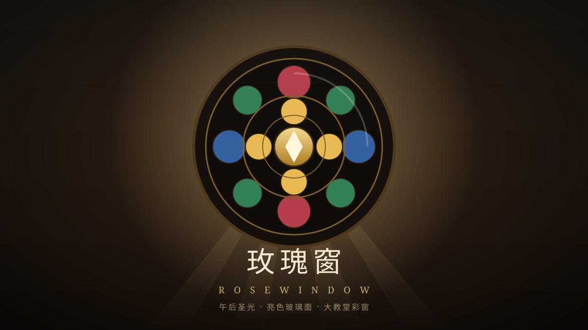

# 玫瑰窗（theme-rose-window）

> LinkDesk 官方主题 · 亮色 · 三配色「午后圣光 / 青金石 / 晚祷紫」
> **理念一句话：** 把 LinkDesk 开在一座法国哥特教堂的中殿里——正午偏后的阳光从玫瑰窗灌进来，界面是几块**发亮的磨砂玻璃**，浮在深色石廊与彩窗之上；光在玻璃表面留下金箔色的一道反光。

## 这是什么

一个**外观主题插件**（不是功能插件）：在 **外观 → 主题** 里选中「玫瑰窗」，整个壳换肤。

- **风格轴**：亮色玻璃（`type: glass`）+ 全窗彩窗背景图 + 中等偏大的圆角；
- **配色轴**：同一个风格基座带 3 组彩窗配色——金箔、青金石、晚祷紫。

## 长什么样

| 层 | 做法 | 观感 |
|---|---|---|
| 最底层 | 全窗背景图 `cathedral-bg.jpg`（亚眠大教堂玫瑰窗，CC0） | 深色石廊里透出宝石红 / 青金 / 祖母绿的彩窗，午后暖光与光柱 |
| 玻璃面 | 标题栏 / 工具栏 / 图标栏 / 侧栏 / 主区 / 面板区 / 状态栏全部走玻璃材质 | 亮色磨砂玻璃，背后彩窗被模糊成温柔的光斑 |
| 玻璃反光 | `specular 0.85` + 暖金高光色 `#FFF2CF` | 每块面板顶部一道金色发丝光边，像玻璃受光 |
| 文字 | 暖调深墨 `#2B2015` / `#57432E` | 亮玻璃上清晰、不刺眼 |
| 强调色 | 金箔 `#A6771B`（青金石 / 晚祷紫配色各换一套） | 选中、按钮、开关、滚动条、拖放指示——中世纪手抄本的金 |

## 玻璃参数

壳主题引擎负责把玻璃真正画出来，主题只声明手感：

| 参数 | 值 | 含义 |
|---|---|---|
| `blur` | 28 | 玻璃背后的彩窗模糊程度 |
| `saturate` | 1.45 | 透过玻璃的彩窗略增饱和 |
| `tint` | `rgba(255,244,222,.58)` | 亮色玻璃的暖白叠加 |
| `opacity` | 0.38 | 配方面玻璃材质的厚度 |
| `specular` / `specularColor` | 0.90 · `#FFF0C4` | 顶部金色受光带 |
| `morph` · `radius` | 300ms · 14 | 表面切换动效 · 悬浮圆角 |
| `shadow` | 开 | 玻璃面板投下柔和暖影 |

> 用户仍可在设置里单独调「玻璃不透明度」——那是合成层旋钮，与本配方的材质厚度相乘生效。

## 背景与遮罩

- 图片：2560×1200 全景图，铺满整个窗口（`mode: panorama`）。
- `mask: 0.12` + 暖黑 `maskColor: #1A1008`：把照片压成「教堂室内的暗」，让亮玻璃面浮起来。
- 换图建议：同尺寸、深色石廊 + 中心偏亮的彩窗最合适；换完把 `mask` 调到你觉得玻璃不脏为止。

## 三组配色

| 配色 | accent | 气质 |
|---|---|---|
| 午后圣光 | `#A6771B` 金箔 | 暖阳、金箔手抄本（默认） |
| 青金石 | `#2F5D9E` | 圣母蓝、青金彩窗 |
| 晚祷紫 | `#6B3F8E` | 黄昏晚祷、紫晶玻璃 |

三组共用同一套亮色玻璃基座与暖墨文字，换配色只换「金 / 蓝 / 紫」这一族强调色。

## 应用

1. **外观 → 主题** → 选 **玫瑰窗**。
2. 在配色里选「午后圣光 / 青金石 / 晚祷紫」。
3. 想更亮/更透：设置里调玻璃不透明度；想更沉：加大背景遮罩。

## 色板（午后圣光 · 主值）

| 角色 | 值 |
|---|---|
| accent / toggle / 滚动条 | `#A6771B`（hover `#C6952F`） |
| 主文字 / 次级 / 弱 | `#2B2015` / `#57432E` / `#7E684E` |
| 玻璃面底 | `#FDF8EE` · `#FBF5E9` · `#FAF3E5` · `#F7EFDF` |
| 卡片（内容面） | `#FFFCF5` |
| 边框 / 分隔 | `rgba(96,70,38,.22)` / `rgba(96,70,38,.15)` |
| 危险 / 警告 / 成功 | `#A32A38` / `#B4761C` / `#2E7D53` |
| 脏点（未保存） | `#B03A46` 鸽血红 |

## 资源与来源

- `resources/cathedral-bg.jpg` —— 巴黎圣母院（Notre-Dame de Paris）北玫瑰窗，**公有领域**，源自 Wikimedia Commons；本仓做了 2560×1200 取景、日光提亮、暖光与光柱合成。
- `resources/cover.svg` / `resources/icon.svg` —— 本仓自绘（玫瑰窗几何）。

## 许可

MIT（见 `LICENSE`）。背景图 CC0，不附加限制。
