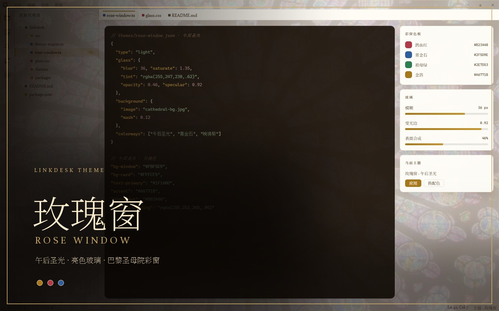

# Rose Window

A cathedral stained-glass theme — afternoon light through a rose window, with luminous frosted glass panes floating above a dark stone nave (gold leaf / lapis / vespers violet colorways)



## What it does

- 1 theme: Rose Window.

## Applying it

- Theme: Settings → Appearance → Theme.

## Install

Open the Plugin Store, find this plugin, and click Install. For offline use, install the `.linkdesk-plugin` package from disk.

## Development

```bash
npm install
npm run dev
npm run lint
npm run verify
npm run build
npm run publish
```

See the repository root `README.md` for the Chinese documentation and the full directory contract.
